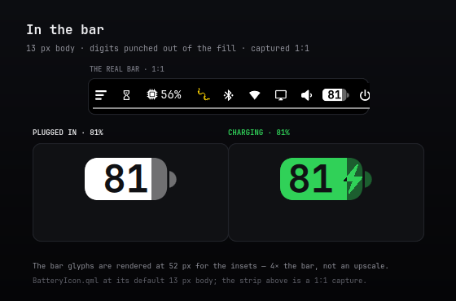
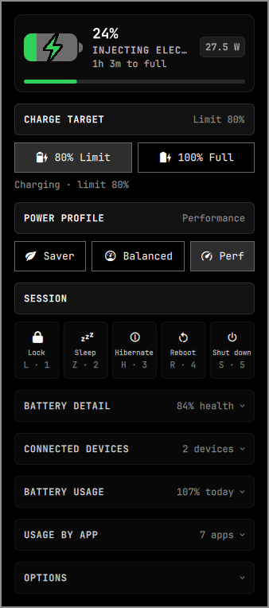
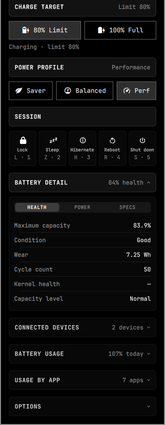
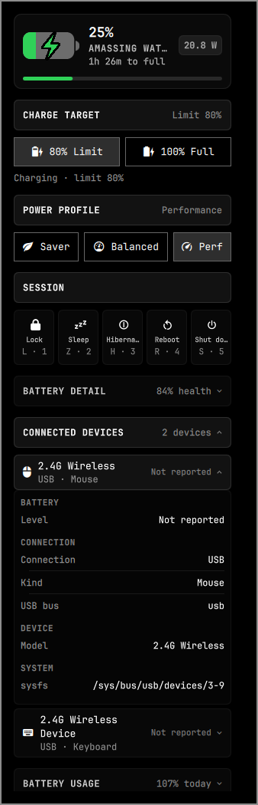
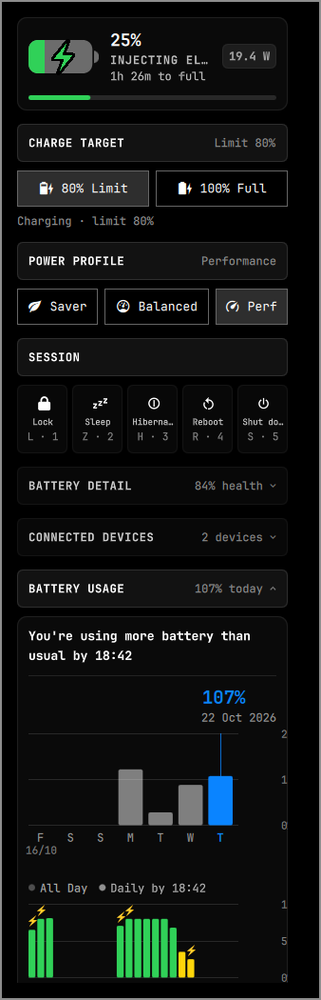
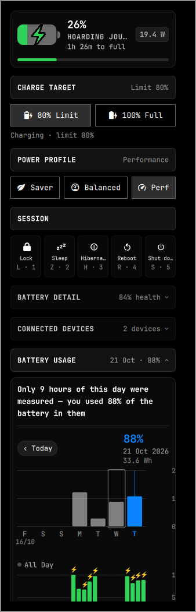
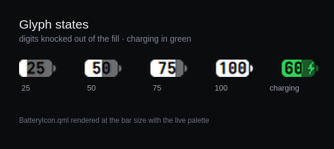
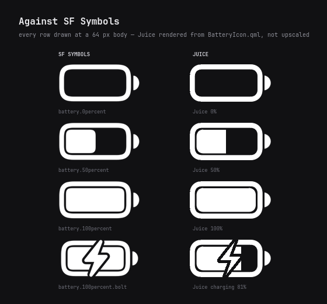
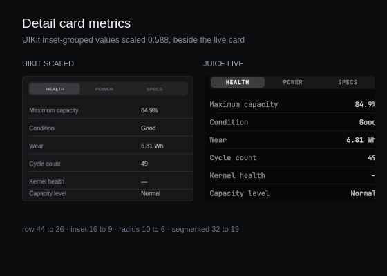

# Juice

Battery bar widget and compact dashboard panel for [Omarchy](https://omarchy.org):

1. **Bespoke Vector Battery** — a custom QML battery component (`BatteryIcon.qml`) drawn to iOS's own proportions: a filled capsule with the percentage punched through the fill, the real SF Symbols bolt path while charging, an outlined glyph when the percentage is hidden, and iOS 27's stroke-free capsule when the borderless option is on.
2. **Fixed, Read-At-A-Glance Panel** — a 338 px card in the Omarchy aesthetic. One permanent hero (level, state, time left, live wattage) is followed by three permanent sections — charge target, power profile and session actions — then five disclosures: battery detail, connected devices, battery usage, usage by app and options. The live controls are always visible; the disclosures start closed (the data sections carry their most useful number) and every open starts on the closed, today view.
3. **Hardware Charge Targets** — `80% Limit` and `100% Full` write the kernel charge threshold directly via sysfs, so a laptop holding at a conservation limit resumes charging instantly.
4. **Rich Hardware Telemetry** — live health %, cycles, energy flow, temperature, voltage, and cell chemistry straight from `/sys/class/power_supply/`.
5. **Smart Automation & Escalation** — Apple's colour semantics (green while charging or full, yellow while Low Power Mode is active, urgent red at or below a configurable threshold), and automatic power-saver profile engagement with a configurable threshold and an on/off switch.
6. **Connected Devices** — every connected peripheral the system reports: Bluetooth headsets, mice and keyboards, 2.4 GHz dongles and gamepads, each with its battery level where the hardware exposes one. Tap a device and it drops down to the full picture — health, cycles, chemistry, temperature, warning level, Bluetooth address and class, pairing state, USB bus, UPower node and when it last reported. The laptop's own pack is deliberately not one of them: the hero carries its level and BATTERY DETAIL carries its health, so it is never printed a third time.
7. **Battery Usage, the iOS way** — the Daily Usage card: a seven-day bar chart of pack used per day with today in blue, the "similar amount of battery as usual by 11:06" comparison, the hour-by-hour level chart with green/yellow/red bars and a bolt on charging hours, Screen On / Screen Off totals, and a per-app usage breakdown — all metered from this machine, never estimated placeholder numbers. Tap a bar and the card opens that day: its own curve, percentage, measured energy and Screen On/Off totals, a sentence naming how many hours were observed when the day is only partly measured, `App breakdown wasn't recorded for this day` when that day has no app rows, and a `‹ Today` chip back to the live view. A day with no measurement at all is never 0%: it shows an empty grid, an em dash for the percentage and `No measurements were recorded for this day`.
8. **Session Actions on a Hold** — Lock, Sleep, Hibernate, Reboot and Shut down sit in one strip, using Omarchy's own glyphs and session commands. Hold the letter shown on a tile for three seconds (or hold the tile with the mouse) to run it; the tile fills and counts down, and releasing early always cancels. `Super+Alt+B` opens the panel when you add the binding below. Session letters are plain keys inside the focused panel — Omarchy's `Super+L` layout cycle and `Super+S` scratchpad are untouched.

## The panel

The hero is permanent. So are **CHARGE TARGET** (`Limit 80%` or
`Unsupported`), **POWER PROFILE** (`Balanced`, `Saver` or `Performance`) and
**SESSION**: no chevron, no click needed. The four data sections and **OPTIONS**
are closed when the panel opens; the data sections carry a summary:

| Section | Behaviour |
| --- | --- |
| CHARGE TARGET | Permanent: threshold buttons and the live charging sentence |
| POWER PROFILE | Permanent: Saver / Balanced / Perf |
| SESSION | Permanent: the five three-second hold actions below |
| BATTERY DETAIL | Collapsible; closed summary `85% health` |
| CONNECTED DEVICES | Collapsible; closed summary `4 devices`, or `None` |
| BATTERY USAGE | Collapsible; `39% today`, or `21 Oct · 88%` while a past day is open |
| USAGE BY APP | Collapsible; `3 apps`, or `Not recorded` on a past day with no app rows; hidden when there is nothing to show |
| OPTIONS | Collapsible; the six widget settings |

The disclosures open independently; tapping a header again closes it, and the
card scrolls when the open bodies are taller than the space under the bar.
Opening the panel resets those five rows, the device drop-down and the usage
day, so it always starts closed on today.

## Session actions

Open Juice with `Super+Alt+B` after adding the binding (see
[Usage](#usage)). The tiles show a letter and a number; hold either for **ten
seconds** to run the action. The tile fills, counts down, and resets the moment
you release early. The mouse uses the same gesture: press and hold a tile.

| Action | Glyph | Hold | Number |
| --- | --- | --- | --- |
| Lock | `` | `L` | `1` |
| Sleep | `󰒲` | `Z` | `2` |
| Hibernate | `󰤁` | `H` | `3` |
| Reboot | `󰜉` | `R` | `4` |
| Shut down | `󰐥` | `S` | `5` |

Sleep and Hibernate are omitted when this machine cannot enter them, matching
Omarchy's own menu rules. A short tap of `H` or `L` still moves the power
profile cursor; holding past 180 ms turns it into the session hold. `Esc`
closes the panel. The session letters are handled only while the panel has
keyboard focus, so `Super+L` still cycles the workspace layout and `Super+S`
still toggles the scratchpad.

## Screenshots

Every pixel below is either a 1:1 capture of the running shell or the QML itself rendered at the size shown — nothing is upscaled.

### In the bar



### The panel











Every other section has its own plate beside these: `panel-charge-target.png`,
`panel-power-profile.png`, `panel-usage-by-app.png` and `panel-options.png`.

### Glyph and references







## Features

- **Percentage inside the icon**: the digits are a knockout in the fill, exactly as iOS 16+ renders them, and never shrink the icon.
- **Live Fluid Fill**: Liquid level changes transition smoothly with cubic easing.
- **Steady Charging Readout**: the digits and the bolt stay fully opaque and static while current flows in, so the bar never flickers or pulses.
- **ThinkPad & Modern Laptop Longevity**: Native support for `charge_control_end_threshold`.


## Requirements

- Omarchy with the Quickshell shell (bar widget plugin support)
- A battery that exposes `charge_control_end_threshold` / `charge_stop_threshold`
  for the charge-target buttons (ThinkPads, and most modern laptops). The health
  section works on any battery.
- `jq` for the installer
- `python3` for battery-usage metering (the card hides its numbers and says so
  when it is missing; every other section keeps working)

## Install

```bash
omarchy plugin add https://github.com/thepathless/Juice.git
~/.config/omarchy/plugins/thepathless.juice/install.sh
```

Or from a local checkout:

```bash
cd Juice
./install.sh
```

`install.sh` is idempotent and does four things:

| Step | What it does | Privilege |
| --- | --- | --- |
| validate | runs `omarchy plugin validate` on the manifest | user |
| place | links/copies the plugin into `~/.config/omarchy/plugins/thepathless.juice` | user |
| restore unit | installs and enables `juice-charge-target.service` (user unit) | user |
| udev rule | installs `99-juice-charge-thresholds.rules` so the thresholds are writable | root (skipped when already writable) |

Finally it enables the widget in the right bar section.

## How the charge targets work

Two layers, no privilege helper at runtime:

- **Privilege** — `udev/99-juice-charge-thresholds.rules` chmods
  `charge_control_start_threshold` / `charge_control_end_threshold` (and the
  older `charge_start_threshold` / `charge_stop_threshold` naming) to `0666` when
  the battery appears. The panel then writes the value directly; there is no
  `pkexec`, polkit policy or root-owned helper in the code path.
- **Persistence** — ThinkPad-class embedded controllers store the thresholds in
  NVRAM, so they already survive a reboot. For hardware that forgets, the
  chosen target is saved to `$XDG_STATE_HOME/juice/charge-target` and
  re-applied by the user unit at login.

Selecting a target writes start `0` (kernel ABI: `0` = no lower bound, i.e.
"threshold off") followed by the stop threshold. Setting the stop threshold back
to `100` is what un-clamps a machine currently holding at 80 — charging resumes
immediately, no reboot and no unplugging needed.

The panel never assumes the write landed: `scripts/juice-set-limit` reads
both attributes back from the controller, reports them, and the section shows
what the hardware actually holds along with its live charging state.

## Bar icon and options

The bar glyph comes from bindings on UPower plus a power-supply uevent monitor
(`udevadm monitor --subsystem-match=power_supply`), so it flips the moment the
hardware does instead of on a timer:

| State | Glyph | When |
| --- | --- | --- |
| Charging | filled to the level, bolt beside the digits (or centred when the percentage is hidden) | current is flowing in |
| Plugged in, not charging | filled to the level, no bolt | on AC, holding at a charge limit |
| Full | full body, no bolt | at 100% |
| Discharging | filled to the level; digits knocked out of the fill when the percentage is shown | running on battery |

Colour follows the state's precedence: **green** while charging or full — even
below the red threshold or in Low Power Mode — then **yellow** while the
`power-saver` profile is active, **red** at or below the configurable threshold
(20% by default), otherwise the bar's own foreground.

The charge limit is the state machine's only boundary: on AC the bar reports
**charging** until the pack reaches `limit - 1`, then **plugged** for as long as
the limit holds; off AC it reports **discharging** regardless of the limit. The
boundary is computed from the local level and limit, so it never waits for
UPower's next poll.

All six options live in the panel's **OPTIONS** section and are stored in this
widget's inline `shell.json` entry — the mechanism every Omarchy bar setting uses
— so they survive a restart:

| Option | Default | Range | Effect |
| --- | --- | --- | --- |
| Percentage inside battery | off | on / off | Level inside the body, punched out of the fill (also on right-click) |
| iOS 27 borderless body | off | on / off | Filled capsule with no outline: the body carries the track and the fill runs flush to its edge, instead of the bordered iOS 16–26 glyph |
| Icon height | 13 px | 11–18, step 1 | Body height of the bar glyph, in the shell's spacing units, so it follows the shell's UI scale. The digits scale with it and never shrink the icon |
| Turn red at or below | 20% | 5–50%, step 5 | Level at which the glyph switches to Apple's red; the threshold is inclusive, so 20% is already red |
| Auto power-saver | on | on / off | Switch the automatic profile change off. Turning it off releases a profile it engaged and restores the one that was active before |
| Power saver at | 50% | 5–95%, step 5 | On battery at or below this level, switch to the `power-saver` profile; release at +3% so it cannot flap. Inactive while Auto power-saver is off |

The two silhouettes differ in more than the outline. Both draw their body from
one geometry table, but the bordered glyph is Apple's SF Symbols shape
(1.947 H wide, 0.330 H corner, 0.135 H stroke, level inset 0.181 H, 0.401 H
terminal) while the borderless one is the reference widget's iOS 27 body
(1.829 H wide with the digits and 1.923 H without, one 12 px corner, no stroke,
a 15 px terminal). Switching the percentage on drops the stroke and the inset
in both styles, so the digits sit in the fill.

`state` reports every option as it is actually applied, next to the live level,
state and colour, so the bar can be checked without reading `shell.json`:

```bash
omarchy-shell thepathless.juice setShowPercentage true
omarchy-shell thepathless.juice setPowerSaverThreshold 50
omarchy-shell thepathless.juice state    # level, state, icon, colour, borderless, iconSize, redBelow, …
```

> **Deliberate deviation from the reference:** at 100% the reference widget
> paints the terminal in the track colour, so a full pill fades into a uniform
> grey. This widget keeps the state colour there (green while full), so the
> whole pill reads as one solid shape. The rule is a single line — `poleColor`
> in `BatteryIcon.qml` — if you prefer the reference's behaviour.

## Command line / IPC

```bash
omarchy-shell thepathless.juice charge100
omarchy-shell thepathless.juice charge80
omarchy-shell thepathless.juice devices   # JSON: every battery device and its details
omarchy-shell thepathless.juice usage     # JSON: today, seven-day series, apps
bash ~/.config/omarchy/plugins/thepathless.juice/scripts/juice-set-limit 100
bash ~/.config/omarchy/plugins/thepathless.juice/scripts/juice-stats
bash ~/.config/omarchy/plugins/thepathless.juice/scripts/juice-devices
python3 ~/.config/omarchy/plugins/thepathless.juice/scripts/juice-usage --report
```

## Connected devices and battery usage

Both surfaces are read-only and grounded in system sources — nothing is
fabricated when the hardware stays silent. Every connected Bluetooth device is
listed, and so is a USB receiver whose HID nodes report a wireless claim, even
when that hardware exposes no battery channel; those rows say `Not reported`
rather than showing 0% or disappearing. That is a hardware limit, not a
detection gap: the device has no battery node to read — for a 2.4 GHz receiver,
neither a `power_supply` node nor a `hidpp_battery` device exists — so there is
nothing to report.

A USB dongle is recognised by what its HID nodes call themselves — `HID_NAME`
and input device names — not by the USB product string, so a receiver that
enumerates as `USB Composite Device` is still listed. Hubs, the AC adapter and
USB-C source nodes are not listed.

A section and a device share one gesture and nothing else: the section header
opens the section, the row inside it opens that one device. Both are closed on
every panel open, as is the usage day, and the headers summarise what is behind
them (`Limit 80%`, `Balanced`, `85% health`, `4 devices`, `39% today` or
`21 Oct · 88%`, `3 apps`).

| Surface | Source |
| --- | --- |
| Device list, levels, health | `upower -d`, connected `bluetoothctl` devices, and USB HID receivers; a peripheral whose hardware exposes no level is still listed as `Not reported` |
| Bluetooth facts | `bluetoothctl info` — address, class, icon, pairing, RSSI, modalias |
| USB / dongle facts | sysfs USB HID interfaces, input names (`… Mouse`, `… Keyboard`), `udevadm`'s `ID_BUS`/vendor database |
| Energy used per day | `/sys/class/power_supply/BAT*/energy_now`, only while discharging |
| Level timeline | the sampler, backfilled on first sight from UPower's `GetHistory` |
| Screen On / Off | Hyprland monitor DPMS state (`hyprctl monitors`) |
| Per-app rows | `/proc/<pid>/stat` CPU ticks attributed through the process tree to the window class that owns it, plus focused-window seconds |

Usage is metered by a sampler that runs with the shell and keeps a 35-day
history in `~/.local/state/juice/usage.json`. During discharge an app's share of
the pack is its portion of the CPU work measured in that interval; display,
idle and kernel work stay in the day total instead of being pinned on an app.
Gaps longer than 15 minutes (suspend, shell restart) are never attributed to
anyone.

CPU work and focused-window time are sampled even while charging. The app list
then shows today's activity shares beside any battery shares measured earlier in
the day, with activity leading on AC; every row states whether its percentage is
"of battery used today" or "of CPU activity today" so a brief discharge can
never hide the charging session. A day with no measurement falls back to the
last measured discharge, and with none at all the section says that nothing was
measured rather than showing zeroes. Focus time is shown only when a window was
actually focused; otherwise the row prints an em dash.

The week's bars are backfilled once from UPower's recorded history, so the card
is populated from the first launch rather than after a week of watching. Days
with no recorded discharge render as empty tracks — there is no made-up number
behind them.

## Uninstall

```bash
~/.config/omarchy/plugins/thepathless.juice/uninstall.sh
# or, for a git-managed checkout:
omarchy plugin remove thepathless.juice
```

`uninstall.sh` disables the widget, removes the user unit and the udev rule and
deletes the symlink when it points at this checkout. It leaves the battery's
current hardware threshold and the saved target file alone.

## Layout

```
Juice/
├── manifest.json                               plugin manifest (schemaVersion 1)
├── Panel.qml                                   bar widget, panel shell, state and IPC
├── BatteryIcon.qml                             vector battery glyph
├── ConnectedDevices.qml                        connected-device list and dropdown
├── SectionCard.qml                             collapsible section header and body
├── UsageCard.qml                               iOS Daily Usage card and charts
├── UsageAppList.qml                            per-app battery usage rows
├── DetailRow.qml                               shared label/value row
├── Model.js                                    state machine and formatting helpers
├── scripts/juice-stats                         read-only sysfs probe
├── scripts/juice-devices                       every battery device as JSON
├── scripts/juice-usage                         battery usage sampler and report
├── scripts/juice-set-limit                     applies/restores a charge target
├── udev/99-juice-charge-thresholds.rules       threshold write access
├── systemd/juice-charge-target.service         login restore unit
├── tests/icon-geometry                         glyph geometry regression check
├── tests/color                                 bar glyph colour precedence
├── tests/devices                               device parsing and detail rows
├── tests/session                               session action catalogue and lookup
├── tests/usage                                 usage aggregation report
├── docs/architecture.md                        layer map, state ownership, data flow
├── docs/screenshots/                           the plates above
├── install.sh
├── uninstall.sh
├── LICENSE
├── README.md
└── .gitignore
```

## License

MIT — see [LICENSE](LICENSE).
