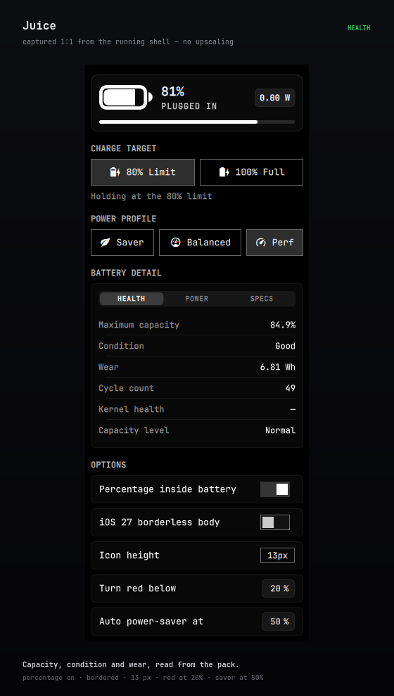
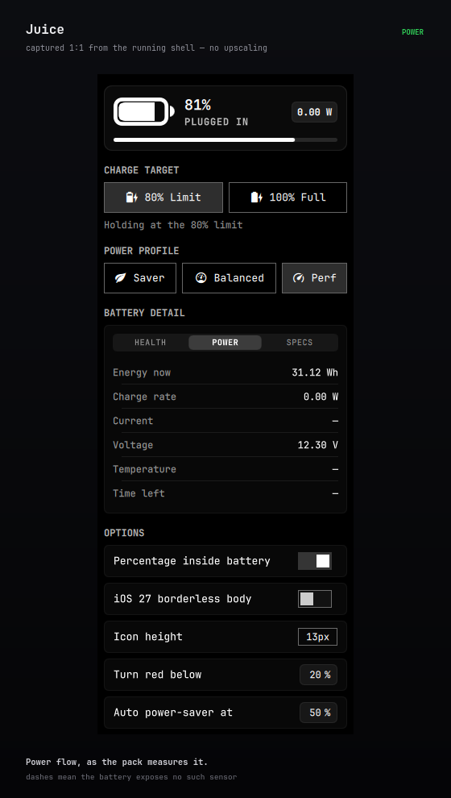
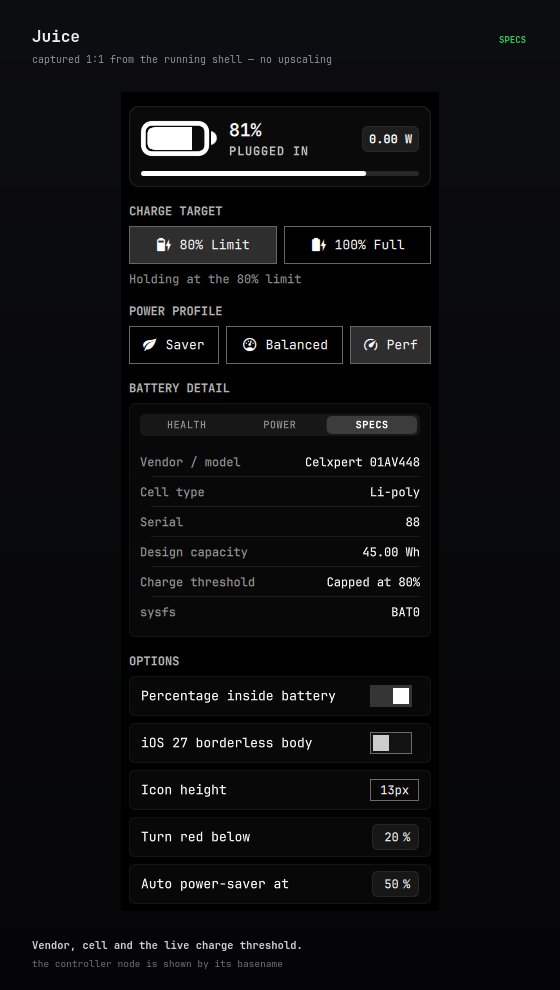

# Juice

Battery bar widget and compact dashboard panel for [Omarchy](https://omarchy.org):

1. **Bespoke Vector Battery** — a custom QML battery component (`BatteryIcon.qml`) drawn to iOS's own proportions: a filled capsule with the percentage punched through the fill, the real SF Symbols bolt path while charging, an outlined glyph when the percentage is hidden, and iOS 27's stroke-free capsule when the borderless option is on.
2. **Compact Modern Dashboard UI** — a sleek 290px card designed in the Omarchy aesthetic: an integrated hero card with live wattage, segmented pill controls for charge limits and power profiles, and a 2x2 Bento grid for hardware telemetry.
3. **Hardware Charge Targets** — `Charge to 80%` and `Charge to 100%` write the kernel charge threshold directly via sysfs, so a laptop holding at a conservation limit resumes charging instantly.
4. **Rich Hardware Telemetry** — live health %, cycles, energy flow, temperature, voltage, and cell chemistry straight from `/sys/class/power_supply/`.
5. **Smart Automation & Escalation** — Apple's colour semantics (yellow while Low Power Mode is active, urgent red at or below a configurable threshold, green while charging or full), and automatic power-saver profile engagement with configurable threshold.

## Screenshots

Every pixel below is either a 1:1 capture of the running shell or the QML itself rendered at the size shown — nothing is upscaled.

### In the bar


### The panel







### Glyph and references


## Features

- **Percentage inside the icon**: the digits are a knockout in the fill, exactly as iOS 16+ renders them, and never shrink the icon.
- **Live Fluid Fill**: Liquid level changes transition smoothly with cubic easing.
- **Steady Charging Readout**: the digits and the bolt stay fully opaque and static while current flows in, so the bar never flickers or pulses.
- **ThinkPad & Modern Laptop Longevity**: Native support for `charge_control_end_threshold`.


## Requirements

- Omarchy with the Quickshell shell (bar widget plugin support)
- A battery that exposes `charge_control_end_threshold` / `charge_stop_threshold`
  for the charge-target buttons (ThinkPads, and most modern laptops). The health
  section works on any battery.
- `jq` for the installer

## Install

```bash
omarchy plugin add https://github.com/thepathless/Juice.git
~/.config/omarchy/plugins/thepathless.juice/install.sh
```

Or from a local checkout:

```bash
cd Juice
./install.sh
```

`install.sh` is idempotent and does four things:

| Step | What it does | Privilege |
| --- | --- | --- |
| validate | runs `omarchy plugin validate` on the manifest | user |
| place | links/copies the plugin into `~/.config/omarchy/plugins/thepathless.juice` | user |
| restore unit | installs and enables `juice-charge-target.service` (user unit) | user |
| udev rule | installs `99-juice-charge-thresholds.rules` so the thresholds are writable | root (skipped when already writable) |

Finally it enables the widget in the right bar section.

## How the charge targets work

Two layers, no privilege helper at runtime:

- **Privilege** — `udev/99-juice-charge-thresholds.rules` chmods
  `charge_control_start_threshold` / `charge_control_end_threshold` (and the
  older `charge_start_threshold` / `charge_stop_threshold` naming) to `0666` when
  the battery appears. The panel then writes the value directly; there is no
  `pkexec`, polkit policy or root-owned helper in the code path.
- **Persistence** — ThinkPad-class embedded controllers store the thresholds in
  NVRAM, so they already survive a reboot. For hardware that forgets, the
  chosen target is saved to `$XDG_STATE_HOME/juice/charge-target` and
  re-applied by the user unit at login.

Selecting a target writes start `0` (kernel ABI: `0` = no lower bound, i.e.
"threshold off") followed by the stop threshold. Setting the stop threshold back
to `100` is what un-clamps a machine currently holding at 80 — charging resumes
immediately, no reboot and no unplugging needed.

The panel never assumes the write landed: `scripts/juice-set-limit` reads
both attributes back from the controller, reports them, and the section shows
what the hardware actually holds along with its live charging state.

## Bar icon and options

The bar glyph comes from bindings on UPower plus a power-supply uevent monitor
(`udevadm monitor --subsystem-match=power_supply`), so it flips the moment the
hardware does instead of on a timer:

| State | Glyph | When |
| --- | --- | --- |
| Charging | filled to the level, bolt beside the digits (or centred when the percentage is hidden) | current is flowing in |
| Plugged in, not charging | filled to the level, no bolt | on AC, holding at a charge limit |
| Full | full body, no bolt | at 100% |
| Discharging | filled to the level; digits knocked out of the fill when the percentage is shown | running on battery |

Colour follows Apple's precedence: **yellow** while the `power-saver` profile is
active (Low Power Mode), **red** at or below the configurable threshold (20% by
default), **green** while charging or full, otherwise the bar's own foreground.

The charge limit is the state machine's only boundary: on AC the bar reports
**charging** until the pack reaches `limit - 1`, then **plugged** for as long as
the limit holds; off AC it reports **discharging** regardless of the limit. The
boundary is computed from the local level and limit, so it never waits for
UPower's next poll.

All five options live in the panel's **OPTIONS** section and are stored in this
widget's inline `shell.json` entry — the mechanism every Omarchy bar setting uses
— so they survive a restart:

| Option | Default | Range | Effect |
| --- | --- | --- | --- |
| Percentage inside battery | off | on / off | Level inside the body, punched out of the fill (also on right-click) |
| iOS 27 borderless body | off | on / off | Filled capsule with no outline: the body carries the track and the fill runs flush to its edge, instead of the bordered iOS 16–26 glyph |
| Icon height | 13 px | 11–18, step 1 | Body height of the bar glyph, in the shell's spacing units, so it follows the shell's UI scale. The digits scale with it and never shrink the icon |
| Turn red at or below | 20% | 5–50%, step 5 | Level at which the glyph switches to Apple's red; the threshold is inclusive, so 20% is already red |
| Power saver at | 50% | 5–95%, step 5 | On battery at or below this level, switch to the `power-saver` profile; release at +3% so it cannot flap |

The two silhouettes differ in more than the outline. Both draw their body from
one geometry table, but the bordered glyph is Apple's SF Symbols shape
(1.947 H wide, 0.330 H corner, 0.135 H stroke, level inset 0.181 H, 0.401 H
terminal) while the borderless one is the reference widget's iOS 27 body
(1.829 H wide with the digits and 1.923 H without, one 12 px corner, no stroke,
a 15 px terminal). Switching the percentage on drops the stroke and the inset
in both styles, so the digits sit in the fill.

`state` reports every option as it is actually applied, next to the live level,
state and colour, so the bar can be checked without reading `shell.json`:

```bash
omarchy-shell thepathless.juice setShowPercentage true
omarchy-shell thepathless.juice setPowerSaverThreshold 50
omarchy-shell thepathless.juice state    # level, state, icon, colour, borderless, iconSize, redBelow, …
```

> **Deliberate deviation from the reference:** at 100% the reference widget
> paints the terminal in the track colour, so a full pill fades into a uniform
> grey. This widget keeps the state colour there (green while full), so the
> whole pill reads as one solid shape. The rule is a single line — `poleColor`
> in `BatteryIcon.qml` — if you prefer the reference's behaviour.

## Command line / IPC

```bash
omarchy-shell thepathless.juice charge100
omarchy-shell thepathless.juice charge80
bash ~/.config/omarchy/plugins/thepathless.juice/scripts/juice-set-limit 100
bash ~/.config/omarchy/plugins/thepathless.juice/scripts/juice-stats
```

## Uninstall

```bash
~/.config/omarchy/plugins/thepathless.juice/uninstall.sh
# or, for a git-managed checkout:
omarchy plugin remove thepathless.juice
```

`uninstall.sh` disables the widget, removes the user unit and the udev rule and
deletes the symlink when it points at this checkout. It leaves the battery's
current hardware threshold and the saved target file alone.

## Layout

```
Juice/
├── manifest.json                               plugin manifest (schemaVersion 1)
├── Panel.qml                                   bar widget + panel
├── BatteryIcon.qml                             vector battery glyph
├── Model.js                                    state machine and formatting helpers
├── scripts/juice-stats                         read-only sysfs probe
├── scripts/juice-set-limit                     applies/restores a charge target
├── udev/99-juice-charge-thresholds.rules       threshold write access
├── systemd/juice-charge-target.service         login restore unit
├── tests/icon-geometry                         glyph geometry regression check
├── docs/screenshots/                           the plates above
├── install.sh
├── uninstall.sh
├── LICENSE
├── README.md
└── .gitignore
```

## License

MIT — see [LICENSE](LICENSE).
