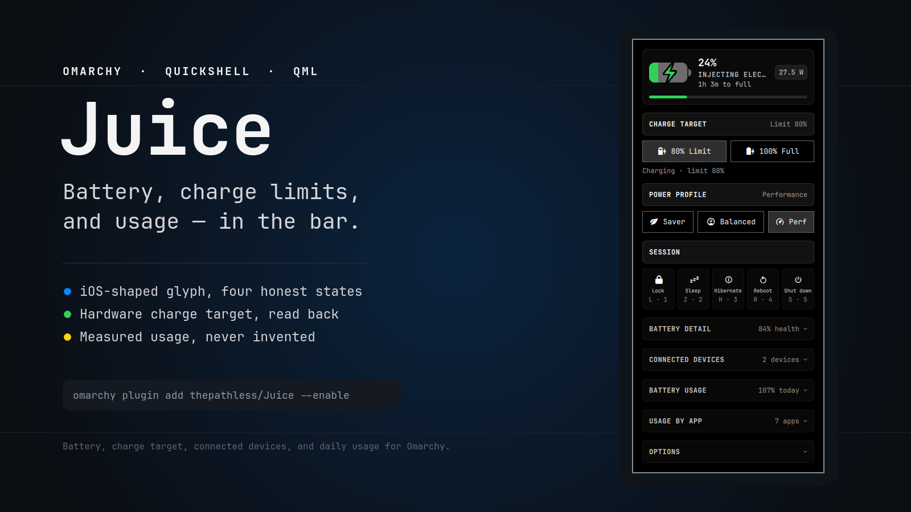
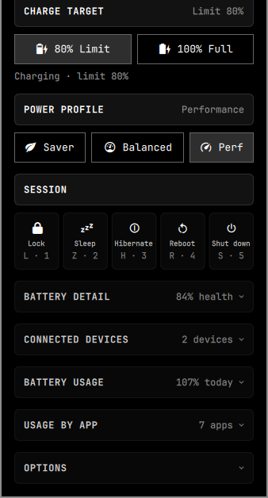
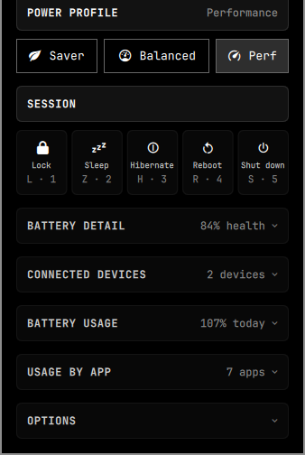
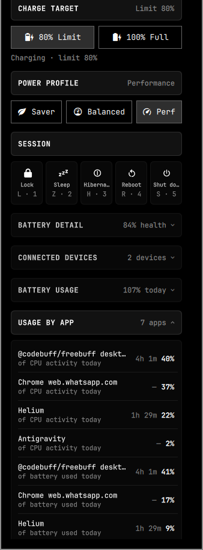
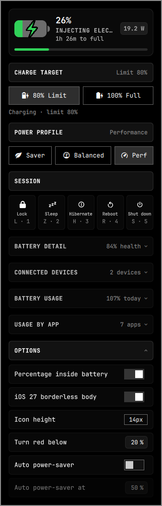

# Juice

**Battery, charge limits, and usage — in the Omarchy bar.**

Juice is a bar widget and compact panel for [Omarchy](https://omarchy.org).
It draws the battery as a real iOS-style glyph, puts the useful controls one
click away, and measures what the machine actually reports instead of filling
gaps with plausible numbers.



## What it does

- **A real glyph** — four honest states, a clipped vector fill, digits cut out
  of the level, optional percentage inside, and an iOS 27 borderless body.
- **A focused panel** — one permanent hero, three permanent controls, and five
  disclosures that start closed and open only when needed.
- **Hardware charge targets** — 80/100 write the controller threshold, read it
  back, and persist it across reboots where the hardware forgets.
- **Measured data** — health, connected batteries, and seven-day usage from the
  system. Missing values stay missing; nothing is invented.

## Requirements

| Requirement | Why |
| --- | --- |
| Omarchy Quattro with the Quickshell bar | The widget is a `bar-widget` plugin |
| A battery exposed by UPower | Without one, Juice hides itself |
| `jq` | The installer and the connected-device probe |
| `python3` | Battery usage metering; the rest of the panel works without it |
| `upower`, `bluetoothctl`, `udevadm` | Device levels, Bluetooth facts, and USB receivers |
| `hyprctl` | Screen On/Off and focused-window time |
| `powerprofilesctl` and Omarchy's profile commands | Power profile controls |
| `systemd --user` | Re-applies the saved charge target at login |
| A battery exposing `charge_control_end_threshold` or `charge_stop_threshold` | Enables the 80/100 controls; health and usage still work without it |

The installer needs root **once** for the udev rule described in
[System changes and removal](#system-changes-and-removal). There is no root
helper in the runtime path.

## Install

```sh
omarchy plugin add https://github.com/thepathless/Juice.git --enable
~/.config/omarchy/plugins/thepathless.juice/install.sh
```

The first command clones and enables the plugin. The second is the one-time
setup: it installs the user unit that restores the charge target, adds the udev
rule that makes the threshold attributes writable, and enables Juice in the
right section. It may ask for your password once for the udev rule.

From a local checkout, run `./install.sh`. Use `install.sh --no-enable` to skip
adding it to the bar. If your battery has no charge threshold, the installer is
only needed for the charge-target controls; the glyph, health, devices, and
usage work without it.

## The bar


- **Left-click** opens or closes the panel.
- **Right-click** toggles the percentage inside the battery.
- Hovering shows the state, level when the glyph hides it, and an explanation
  when the controller is holding at a charge limit.

The glyph is one component, `BatteryIcon.qml`, drawn from Apple's own
proportions. The digits are part of the fill: when a digit straddles the level
edge, the part over the empty track takes the bar's ink and the part over the
fill becomes a hole. Charging keeps the digits solid and steady instead of
pulsing.

| State | Glyph | When |
| --- | --- | --- |
| Charging | Filled to level, bolt beside the digits or centred | Current is flowing in |
| Plugged in | Filled to level, no bolt | On AC, holding at a limit |
| Full | Full body, no bolt | At 100% |
| Discharging | Filled to level, digits in the fill | The battery is the source |

Colour follows the state's precedence: green while charging or full, then
yellow while the `power-saver` profile is active, then red at or below the
configurable threshold, otherwise the bar's own foreground. The threshold is
inclusive: at the default 20%, 20% is already red.

The bar is bound to UPower; a `power_supply` udev monitor refreshes the hardware
figures when the controller changes, so it does not wait for a timer. The glyph
also rotates on a vertical bar.

| Glyph states | Against SF Symbols |
| --- | --- |
|  |  |

## The panel


The card is 338 px wide at the default UI scale and scrolls when an open
disclosure makes it taller than the space under the bar. Opening it resets all
five disclosures, the device drop-down, and the selected usage day.

The hero is permanent: level, rotating status line, time remaining, live
wattage (or `AC` / `BAT` when the hardware reports no rate), and a level bar.
So are the first three rows below; the other five disclose, each carrying a
useful number while closed.

| Section | Closed summary | What it shows |
| --- | --- | --- |
| **CHARGE TARGET** | `Limit 80%` | 80/100 buttons and the live controller sentence |
| **POWER PROFILE** | `Balanced` | Saver, Balanced, Performance |
| **SESSION** | — | Lock, Sleep, Hibernate, Reboot, Shut down |
| **BATTERY DETAIL** | `84% health` | Health, power, and hardware tabs |
| **CONNECTED DEVICES** | `2 devices` | Device levels and grouped facts |
| **BATTERY USAGE** | `39% today` | Seven-day and hourly charts |
| **USAGE BY APP** | `3 apps` | Per-app shares and focus time |
| **OPTIONS** | — | Six widget settings |

Every disclosure opens independently; tapping its header again closes it.

### Charge target



`80% Limit` sets the stop threshold to 80. `100% Full` writes 100, which
releases a machine that is currently holding at a lower limit, so charging
resumes without a reboot or an unplug.

The writer, `scripts/juice-set-limit`, first writes `0` to the start threshold
(the kernel's "no lower bound"), then writes the stop threshold, then reads both
back. Juice displays the read-back values, not the request. If the controller
keeps a different value, the panel says so and the target is not saved.

The saved target lives in `$XDG_STATE_HOME/juice/charge-target` and is re-applied
by `juice-charge-target.service` at login. ThinkPad-class controllers already
store the thresholds in NVRAM, so the unit is a no-op there; it exists for
hardware that forgets.

### Power profile



Clicking a profile applies it through Omarchy's per-power-source command, so
the choice is remembered for AC and battery separately.

**Auto power-saver** is a separate switch, on by default. Juice switches to
`power-saver` at or below the configured level while on battery, then releases
at three points above that level or when AC returns. The hysteresis stops a
battery hovering at the boundary from flapping between profiles. Turning the
switch off releases a profile the automation engaged and restores the one that
preceded it.

### Session

Lock, Sleep, Hibernate, Reboot, and Shut down are one strip. Press and hold a
tile — or hold its letter or number — for **three seconds**. The tile fills and
counts down; releasing early cancels, and nothing runs from the background.

| Action | Letter | Number |
| --- | --- | --- |
| Lock | `L` | `1` |
| Sleep | `Z` | `2` |
| Hibernate | `H` | `3` |
| Reboot | `R` | `4` |
| Shut down | `S` | `5` |

Sleep and Hibernate disappear when this machine cannot enter them, matching
Omarchy's own menu rules. The numbers follow the rows that are actually shown.

`L` and `H` also mean left and right for the power-profile cursor. A short tap
first activates that cursor; the next short tap moves it. Holding either past
180 ms becomes the session hold. The letters are claimed only while the panel
has keyboard focus, so `Super+L` and `Super+S` keep their Omarchy meanings.

`Esc` closes the panel. `Tab` / `Shift+Tab` move between panels. Arrow keys and
`h`/`j`/`k`/`l` activate and move the profile cursor; `Enter` or `Space` applies
the selected profile.

### Battery detail


Three tabs, six rows each. The tab resets to HEALTH when the panel is reopened.

| Tab | Rows |
| --- | --- |
| **HEALTH** | Maximum capacity · Condition · Wear · Cycle count · Kernel health · Capacity level |
| **POWER** | Energy now · Charge rate · Current · Voltage · Temperature · Time left |
| **SPECS** | Vendor / model · Cell type · Serial · Design capacity · Charge threshold · sysfs path |

### Connected devices


Juice lists the battery devices the system actually reports: Bluetooth
headsets, mice, keyboards, touchpads, gamepads, phones, UPSes, and 2.4 GHz
receivers. The laptop's own pack is deliberately absent; the hero and BATTERY
DETAIL already carry it.

A row shows the device name, `connection · kind`, and the level. A device whose
hardware exposes no battery channel is kept as **`Not reported`** — never 0%,
and never dropped. Tapping it opens only the groups that have something to say:

| Group | Rows |
| --- | --- |
| **BATTERY** | Level · State · Health · Cycles · Technology · Temperature · Warning level · Time to empty/full · Rechargeable · Last report |
| **ENERGY** | Energy · Full charge · Design capacity · Reported rate · Voltage |
| **CONNECTION** | Connection · Kind · Bluetooth address · Class · Signal · Paired · Trusted · Modalias · USB bus |
| **DEVICE** | Vendor · Model · Serial |
| **SYSTEM** | UPower node · sysfs path · History recorded |

The list refreshes every 15 seconds while the panel is open, and once at
startup. An empty list says `No battery-powered devices are connected`.

### Battery usage


The card follows iOS's Daily Usage shape:

- a seven-day chart with a dim **All Day** bar and a brighter **Daily by
  HH:MM** bar for today;
- the “similar amount of battery as usual by 11:06” comparison, built only from
  measured days;
- an hour-by-hour level chart: green at 50% or above, yellow from 20–49%, red
  below 20%, with a bolt above charging hours;
- **Screen On** and **Screen Off** totals.

Tapping a bar opens that day. The selected day gets its own percentage, date,
measured energy, curve, and totals; a ring marks its bar and `‹ Today` returns
to the live view.


The card is explicit about missing data. A measured day with holes says how many
hours were observed before quoting a percentage. A day with no measurement is an
empty grid with `—` and `No measurements were recorded for this day`, never
`0%`. A measured day with no app rows says so underneath.

Usage is metered by `scripts/juice-usage`, which runs with the shell and keeps
35 days in `~/.local/state/juice/usage.json`. It samples every 60 seconds,
ignores gaps longer than 15 minutes (suspend, shell restart), backfills the week
from UPower's recorded history, and uses Hyprland's DPMS state for Screen
On/Off. During discharge, an app's share is its portion of measured CPU work;
display, idle, and kernel work stay in the day total instead of being pinned on
an app.

### Usage by app



Up to eight rows, ordered by share. Every row names what its percentage means:
`of battery used today` or `of CPU activity today`. Focus time is shown only
when a window actually held focus; otherwise the row prints `—`. A past day
with no app rows says `App breakdown wasn't recorded for this day`.

CPU activity and focus time are sampled even while charging, so a brief
discharge cannot hide the charging session. A day with no battery measurement
falls back to the last discharge; with none at all, the section says that
nothing was measured rather than showing zeroes.

### Options



| Option | Default | Range | Effect |
| --- | ---: | --- | --- |
| Percentage inside battery | off | on/off | Digits inside the body; also right-click |
| iOS 27 borderless body | off | on/off | Stroke-free capsule instead of the outlined glyph |
| Icon height | 13 px | 11–18, step 1 | Body height in the shell's spacing units |
| Turn red below | 20% | 5–50, step 5 | Inclusive red threshold |
| Auto power-saver | on | on/off | Enables both engagement and release |
| Auto power-saver at | 50% | 5–95, step 5 | On-battery engagement level; disabled while auto is off |

All six live in this widget's inline `~/.config/omarchy/shell.json` entry, the
same place every Omarchy bar setting lives, so they survive a restart. The
number fields accept direct entry, clamp to the manifest range, commit on
Return or blur, and cancel on Escape.

## How it reads the machine

| Source | Feeds |
| --- | --- |
| UPower's display device and `omarchy-battery-status` | Level, state, time remaining, hero |
| `scripts/juice-stats` | Health, energy, thresholds, temperature, AC |
| `scripts/juice-devices` | UPower, BlueZ, and USB HID battery devices |
| `scripts/juice-usage` | Energy, level history, DPMS, CPU work, focus time |
| `udevadm monitor --subsystem-match=power_supply` | Immediate sysfs refresh after a hardware change |

The panel refreshes battery and profiles every 5 seconds while open, connected
devices every 15 seconds, and usage every 60 seconds. The usage sampler runs
continuously. The detailed JSON contracts, process cadence, and state ownership
are in [docs/architecture.md](docs/architecture.md).

Juice does not estimate a missing level, turn an unmeasured day into zero, or
attribute idle and display work to an application.

## System changes and removal

The only privileged setup is the udev rule. It sets mode `0666` on these
power-supply attributes, and nothing else:

```text
/sys/class/power_supply/BAT*/charge_control_{start,end}_threshold
/sys/class/power_supply/BAT*/charge_{start,stop}_threshold
```

The rule is installed once by `install.sh`; after that the panel writes the
thresholds directly. There is no `pkexec`, polkit policy, or root-owned helper
in the runtime path. The installer also adds a **user** systemd unit that
re-applies the saved target at login.

```sh
~/.config/omarchy/plugins/thepathless.juice/uninstall.sh
# or, for a git-managed checkout:
omarchy plugin remove thepathless.juice
# keep the udev rule:
./uninstall.sh --keep-udev
```

Removal disables the widget, removes the user unit, removes the plugin symlink
when it points at this checkout, and removes the udev rule unless you ask to
keep it. It leaves the battery's current hardware threshold and the saved target
file alone.

Community plugins run unsandboxed inside the long-lived Omarchy shell, so review
the source before enabling it, just as you would any bar plugin.

## Control

```sh
omarchy-shell thepathless.juice state       # level, state, colour, options
omarchy-shell thepathless.juice charge80
omarchy-shell thepathless.juice charge100
omarchy-shell thepathless.juice devices     # JSON
omarchy-shell thepathless.juice usage       # JSON
```

Other IPC methods: `open`, `close`, `show`, `hide`, `toggle`,
`togglePercentage`, `setShowPercentage`, `setRedThreshold`, and
`setPowerSaverThreshold`. The optional panel binding is:

```lua
o.bind("SUPER + ALT + B", "Battery (Juice)", "omarchy-shell thepathless.juice toggle")
```

Add it to `~/.config/hypr/bindings.lua`, then reload Hyprland.

## Development

```sh
for test in tests/color tests/devices tests/icon-geometry tests/session tests/usage; do
  bash "$test" || exit 1
done
omarchy plugin validate .
```

The layer map, state ownership, data flow, and probe contracts are documented in
[docs/architecture.md](docs/architecture.md).

## License

MIT — see [LICENSE](LICENSE).
